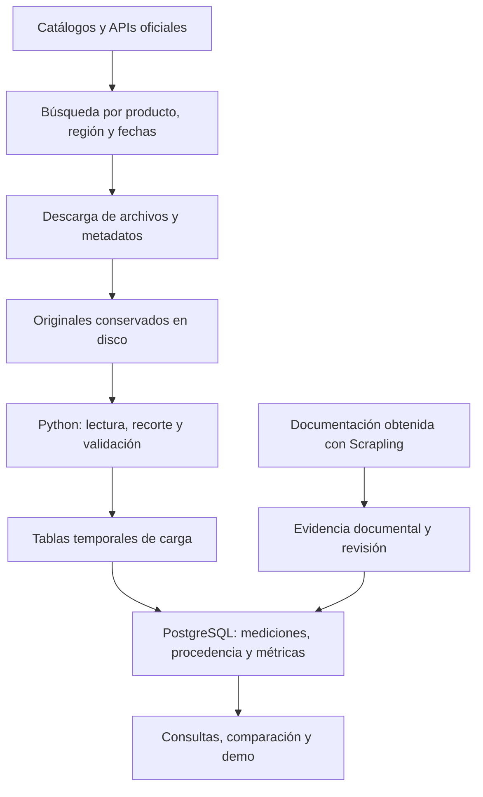

# Recopilación científica y almacenamiento en PostgreSQL

Estado: diseño propuesto, pendiente de implementación y prueba con una muestra. No existe todavía una base PostgreSQL conectada ni un ETL científico ejecutado. Complementa [variables](VARIABLES_PROTOTIPO.md) y [temperatura](TEMPERATURA_EARTH2STUDIO.md).

## Arquitectura recomendada para el MVP

El flujo principal será batch bajo demanda. No hace falta programar descargas continuas para una comparación histórica. Después de demostrar el recorrido completo, las nuevas fechas se pueden incorporar incrementalmente.

Los archivos originales NetCDF/HDF/GeoTIFF/PDS se conservan en disco durante el prototipo. PostgreSQL almacena su catálogo y las mediciones seleccionadas para el análisis, además de las métricas. Esto permite consultar valores numéricos y conservar la fuente científica sin cargar una copia de cada píxel global en tablas.

Si en el futuro se necesitan consultas SQL sobre rásteres completos, PostGIS Raster permite importarlos, pero no es un requisito inicial. Su conveniencia depende del volumen, las consultas y la operación del equipo. [PostGIS Raster](https://postgis.net/docs/using_raster_dataman.html).

## 1. Definir la solicitud

Guardar explícitamente:

- Lugar y cuerpo: Tierra, Luna o Marte; subregión concreta y sistema de coordenadas.
- Producto, versión e identificador de variable del proveedor.
- Periodo, horas requeridas y geometría del área.
- Objetivo de extracción: celda, conjunto de celdas o resumen regional.
- Método, parámetros y versión del código.

La variable física canónica debe distinguir temperatura del aire, temperatura superficial modelada, LST recuperada de observaciones y temperatura de brillo por canal. No se unifican todas bajo una columna semántica «temperatura».

## 2. Encontrar y descargar

| Fuente | Conector propuesto | Material recibido |
|---|---|---|
| NASA Earthdata | `earthaccess` | Granules de productos terrestres y sus metadatos. |
| Copernicus CDS | `cdsapi` | Resultado de la selección de variables, región y tiempos en el formato solicitado/admitido. |
| PDS y nodos de instrumentos | Búsqueda oficial y descarga HTTP del producto | Archivo científico con etiquetas y documentación; el lector depende del producto. |
| Estudios y portales documentales | Scrapling y revisión | Pasajes, localizadores y referencias, separados de mediciones procesadas. |

Consultar primero el catálogo; descargar únicamente la muestra necesaria. Guardar solicitud y respuesta de metadatos sin contraseñas ni tokens. Algunas fuentes requieren cuenta y aceptación de términos. [Earthaccess](https://earthaccess.readthedocs.io/en/stable/user/quick-start/) · [CDS API](https://cds.climate.copernicus.eu/how-to-api).

Una descarga se escribe inicialmente como temporal. Solo tras completarla y validarla se promueve a archivo definitivo; una transferencia truncada no se publica como producto disponible. Registrar tamaño, SHA256 propio y checksum del proveedor cuando exista. El hash propio identifica los bytes recibidos; sin un checksum del proveedor no prueba por sí solo su autenticidad científica.

## 3. Leer, validar y extraer

Python, con el lector adecuado al formato, realiza:

1. Comprobar que el archivo se abre y contiene las variables y dimensiones esperadas.
2. Leer unidad, escala, offset, faltantes, QA, coordenadas y tiempo.
3. Aplicar máscara de calidad y recorte sin inventar resolución ni sustituir faltantes por cero.
4. Conservar los archivos originales; producir valores normalizados con transformación documentada.
5. Extraer las celdas seleccionadas o generar un resumen regional explícito.

Una celda de 1 km o de 0,25° representa un soporte espacial, no un sensor instalado en el punto del sitio. Guardar centro, huella o identificador de celda y resolución. Para promedios regionales, documentar máscara y ponderación por área cuando corresponda.

La ausencia de cobertura y el rechazo por QA deben quedar registrados. Un registro sin valor debe tener motivo; un promedio se acompaña de número de muestras y proporción válida.

## 4. Modelo de PostgreSQL

| Tabla | Propósito | Campos principales propuestos |
|---|---|---|
| `sites` | Sitios y regiones | ID, nombre, cuerpo, longitud/latitud, convención de coordenadas, geometría o huella y CRS. |
| `products` | Definición del producto | ID, proveedor, colección, versión, DOI/URL, tipo de evidencia y condiciones de uso. |
| `assets` | Archivos concretos | ID, producto, identificador del granule/archivo, URI local, SHA256, tamaño, cobertura y metadatos JSONB. |
| `variables` | Significado de la magnitud | Código, definición, unidad canónica, medio/profundidad/canal cuando corresponda. |
| `ingestion_runs` | Ejecución de adquisición y transformación | ID, solicitud sin secretos, estado, fechas, versión del código, parámetros y error. |
| `measurements` | Valores extraídos de celdas o registros | ID, asset, variable, ejecución, celda/registro, tiempo original y normalizado, valor, unidad y QA. |
| `site_samples` | Relación entre sitio y mediciones | Sitio, medición, método de selección e intersección/peso espacial cuando corresponda. |
| `site_metrics` | Resúmenes analíticos por sitio | ID, sitio, variable, periodo, estadístico, valor, unidad, escala, número de muestras, cobertura y método. |
| `metric_inputs` | Procedencia de cada resultado | Métrica, mediciones de entrada o selección reproducible identificada de una ejecución. |
| `documentary_evidence` | Evidencia de literatura | Fuente, localizador, afirmación reportada, valor si corresponde, tipo y revisión. |

Estas son tablas lógicas propuestas, no una migración aplicada. Para el primer recorrido se implementan únicamente las necesarias para el producto elegido. La relación `site_samples` evita duplicar la misma celda porque dos sitios caigan dentro de ella.

Reglas de integridad:

- Claves foráneas para enlazar mediciones, productos y ejecuciones.
- Identidad estable del producto/archivo por proveedor, versión e identificador; si cambian sus bytes, conservar la nueva revisión y la anterior.
- Unicidad de cada medición por asset, versión/método de extracción, variable, celda/registro, tiempo y nivel/canal aplicables.
- Índices sobre sitio, variable y tiempo para consultas frecuentes; seleccionar índices definitivos con las consultas del MVP.
- No imponer rangos físicos globales sin revisar producto y variable. Validar por contrato de cada fuente.

## Coordenadas y tiempo planetarios

PostGIS puede utilizarse para los sitios terrestres y sus intersecciones. **No asignar EPSG:4326 a las coordenadas lunares o marcianas:** ese CRS corresponde a la Tierra. Conservar cuerpo, radio/elipsoide, tipo de latitud, sentido y rango de longitud, y WKT/CRS del producto. La geometría planetaria requiere un CRS apropiado y validado; mientras tanto, mantener sus coordenadas nativas y hacer el procesamiento en Python.

Guardar UTC en `timestamptz` cuando pueda determinarse, y conservar el tiempo original, la escala temporal y la conversión. Registrar hora solar/estación planetaria si existen y son necesarias. Un píxel de un compuesto temporal debe tener inicio/fin del intervalo, no una fecha presentada falsamente como instante de observación.

## 5. Cargar sin duplicados

Para el MVP usar Python con `psycopg`. El flujo de carga propuesto es:

1. Registrar la ejecución y resolver identidades de producto/archivo.
2. Enviar lotes a una tabla temporal mediante `COPY FROM STDIN` del cliente.
3. Verificar filas, unidades, identidades y referencias.
4. Insertar en las tablas finales con restricciones de unicidad y `ON CONFLICT` sobre claves definidas; no reemplazar datos diferentes silenciosamente.
5. Calcular métricas con su selección y método; cerrar la transacción y marcar la ejecución como completa.

`COPY FROM STDIN` evita depender de que el servidor PostgreSQL pueda leer las rutas del equipo que descarga. `COPY` es un mecanismo de transferencia; la deduplicación debe implementarse mediante las claves y la carga desde staging. [Documentación PostgreSQL](https://www.postgresql.org/docs/current/sql-copy.html).

Los archivos y PostgreSQL no comparten una transacción. Un fallo de carga puede dejar un archivo descargado sin mediciones publicadas: el inventario y el estado de ejecución permiten reintentar sin repetir una descarga íntegra. Los backups deben cubrir tanto la base como los archivos referenciados.

## 6. Uso posterior

Una consulta podrá obtener, para un sitio y periodo, la distribución térmica, la fracción válida y los archivos que sustentan cada valor. El análisis comparativo filtra variables compatibles y conserva por separado resultados de observaciones, reanálisis y literatura.

La demo puede leer PostgreSQL mediante FastAPI; una exportación local de resultados permite reproducirla sin volver a consultar los proveedores. No hace falta añadir Airflow, Kafka, Kubernetes o una infraestructura distribuida a este recorrido.

## Primera entrega verificable

Completar un único flujo con temperatura superficial de un sitio terrestre y un periodo corto:

**Búsqueda → descarga → archivo íntegro → lectura y QA → PostgreSQL → consulta de valores y procedencia.**

Aceptación: volver a ejecutar no duplica mediciones; una fila consultada llega a su archivo y variable; los faltantes se distinguen de cero; los recuentos de carga coinciden con los datos extraídos. Un fallo de conexión o calidad queda registrado. Después se añade una muestra planetaria compatible y se reproduce la comparación.
